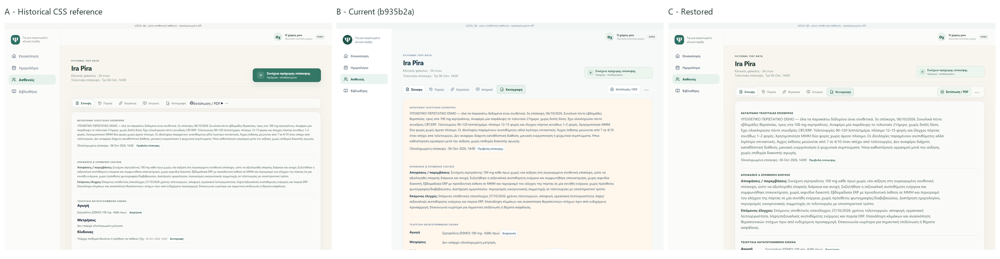
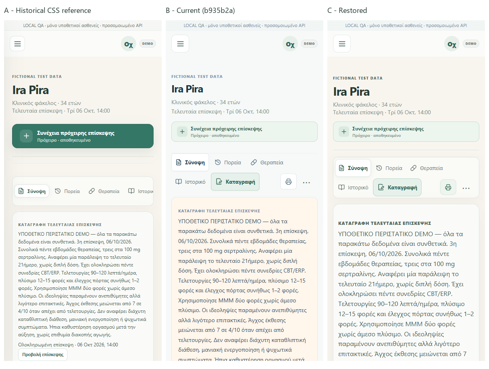
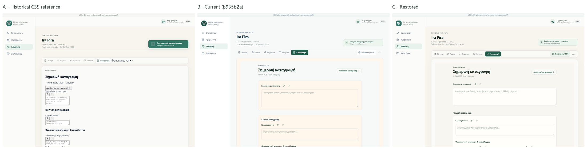
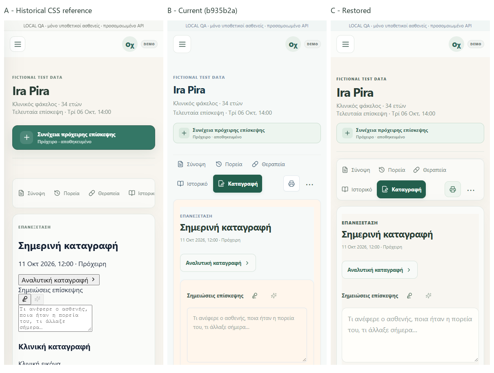

# Historical patient workspace restoration

The patient folder now uses its original warm ivory canvas and translucent, almost-white content surfaces. The cool canvas and peach card patch are removed from this workspace. Current clinical forms, tab routing, draft recovery, medication controls, and save callbacks remain intact.

This is a focused PR stacked on `refine/patient-clinical-ux` (PR #98), starting from `b935b2a5eeb1bc8a29eb791b71818577eb2f1cc9`. It does not promote a deployment or merge the broader clinical branch into main.

## Historical source of truth

| Commit | Contribution |
| --- | --- |
| `fa64b996d910a1773348e4bcc18f9032d955935d` | Adds `.workspace { background:#f8f5ef; min-height:100vh; }` and topbar `#fbfcfa` in `PatientRecord.module.css`. |
| `5de97988974c3dbd9a17e30d7bc6e1d42670722c` | Applies the CSS module workspace class to the patient detail section, scoping the canvas. |
| `a5bae2a8e44528239981f3be098fb0260df2f1d3` | Empty redeploy commit; no new CSS or JSX. |
| `0fc759eba67ee517a1803f39410eac170116c592` | Defines the premium hero, navigation, content surface, inner cards and tables. |
| `f41e11dc85de4594f2fb5f9eb719e9096595c6c5` | Activates the premium hero and content surface classes in JSX. |
| `2f444f582ffb5c04553fa37c1f114cd14d130873` | Empty redeploy commit; complete activated historical reference. |

Recovered values from `2f444f582:components/patients/PatientRecord.module.css`:

| Surface | Exact values restored |
| --- | --- |
| Patient canvas | `#f8f5ef`, minimum height `100vh` |
| Topbar / sidebar | `#fbfcfa` |
| Hero | `18px 0 20px` padding, `16px` bottom margin, divider `rgba(215,224,219,.78)`, heading `#263a32` |
| Navigation | `rgba(251,252,250,.72)`, border `#e1e7e3`, radius `14px`, padding `5px`, gap `4px`, shadow `0 7px 24px rgba(31,49,40,.035)` |
| Active ordinary tab | White, ink `#315f52`, shadow `0 2px 10px rgba(31,49,40,.06)`, inset outline `#dce6e0` |
| Content surface | `rgba(251,252,250,.88)`, border `#e1e7e3`, radius `20px`, padding `24px 26px 26px`, minimum height `360px`, shadow `0 16px 50px rgba(31,49,40,.05)` |
| Inner cards / tables | White, borders `#e2e8e4` / `#e0e7e3`, historical table heading `#f5f8f6` |
| Visit palette | From historical `app/visit-workspace.css`: canvas `#f8f6f1`, surface `#fffefa`, line `#e2e7e3`, ink `#263a34`, sage ink `#315e50` |

The historical visit palette also contained `#f6e9df` as an accent. It was not the patient canvas or default card fill. No new peach palette is introduced. Current stronger muted text (`#5c7064`) and larger readable clinical text are retained; the current distinct Record action and compact draft action are preserved. The module scopes `--line`, `--muted`, and green tokens so the unrelated cool global tokens cannot tint the patient folder.

## Regression cause

1. `621fde07d82f2557f78b61d0d98537c35cbd4ada` first flattened the original surfaces: removed tab/content shadows, reduced the content radius from 20px to 16px, and compressed hero spacing. Its readability and responsive improvements are retained, while the premium surface geometry is restored.
2. `4b78c20cf26fd15d74eb1463f5d36a094f67d5d6` imported `app/noima-ui.css` after the established clinical styles and appended a new module override block. It replaced the canvas with `#f6f9f8`, changed text/borders to cool blue-grey, made navigation transparent with only a bottom rule, flattened content shadows, and forced clinical containers/editors white through broad rules and `!important` declarations. It also changed patient chrome and medication table presentation.
3. `b935b2a5eeb1bc8a29eb791b71818577eb2f1cc9` changed paper/card fills to `#fff6ec` without repairing the cool canvas, flattened navigation, border hierarchy, or visit overrides. This produced peach-filled cards rather than the original warm canvas with near-white cards.

## Implementation scope

- `components/patients/PatientRecord.module.css`: recovered patient tokens, premium hierarchy, header spacing, patient-only sidebar styling, and historical visit palette. Repeated exact-selector rules were consolidated, with superseded declarations removed. Current responsive behavior and medication controls remain.
- `components/patients/PatientWorkspace.tsx`: adds one module class to the existing outer shell; no state, API, clinical form, navigation, or save changes.
- `app/noima-ui.css`: removes the later global recording/medication presentation overrides and resets the earlier peach paper patch to neutral white. The unrelated app chrome keeps its existing palette.
- Browser fixtures and `clinical-ui.yml`: add a full workspace check, include the complete layout stylesheet stack in the existing clinical test, run both suites in CI, and upload their screenshots.

No live patient data, database schema, calculations, APIs, or persistence logic was changed. The test-only Ira Pira JSON is fictional and never imported by an application route. Existing editor mount/autosave requests receive local fixture acknowledgements only.

## Visual evidence and limitations

Same synthetic Ira Pira, three completed fictional OCD visits and a local-only draft; desktop 1440×1000 and mobile 390×844. Screenshots show Summary and Record comparisons, plus all five restored tabs in the exported evidence.

There is no recovered original historical screenshot. **A is a historical CSS reconstruction on the current component tree**, using all CSS available in `2f444f582` and empty replacements for later-only stylesheets. Historical JSX was inspected to confirm the workspace/hero/content class attachment and hierarchy, but was not restored or executed. A therefore documents the original surface palette and geometry, not a pixel-exact historical application snapshot. B uses the `b935b2a` CSS snapshot on the same current tree. C uses the restored current implementation. Current readable typography, controls and information architecture account for expected differences between A and C.

Figma-assisted palette reconstruction uses separate historical patient variables and copies of the existing screens; original designs are preserved. [Warm Summary reference](https://www.figma.com/design/Ef05F0MGIw1Gipvy9KrwCy?node-id=8-90), [Warm Record reference](https://www.figma.com/design/Ef05F0MGIw1Gipvy9KrwCy?node-id=8-153). These validate the palette/surface relationship; browser screenshots are the implementation evidence.

## Validation

- Repository unit/integration tests: **350/350 passed**.
- TypeScript: passed (`tsc --noEmit --incremental false`).
- Lint: passed (`eslint app components lib --max-warnings 0`).
- Production build: passed (`next build`), including final TypeScript verification. Existing nonblocking Next ESLint plugin warning remains.
- New patient visual suite: **10/10 passed**, five tabs at both viewports. Exact canvas/navigation/content values asserted; no horizontal document overflow or browser exceptions.
- Existing clinical editor browser suite with `noima-ui.css` included: **9/9 passed**. Includes initial and follow-up surfaces, mobile widths, MSE, legacy note preservation, recorder interactions, and save-contract checks against synthetic persistence.
- Visual inspection: historical warmth, white/ivory separation, patient chrome, navigation, inner clinical sections, borders and restrained shadows checked at both sizes. Main ink/canvas contrast is 11.13:1; clinical body text 6.89:1; muted text 4.88:1. Hero kicker and sidebar subtitle use later accessible warm text tokens instead of the lower-contrast historical muted values.
- `git diff --check`: passed.

Browser suites use Playwright and esbuild (the existing CI workflow installs them). Run from the repo with `node browser-tests/warm-patient-workspace.mjs` and `node browser-tests/clinical-cleanup.mjs`. Local execution used the installed Chrome channel and bundled tooling; CI uses Chromium. Browser/API responses are fixture-only; this is not a hosted auth or live Supabase verification.
